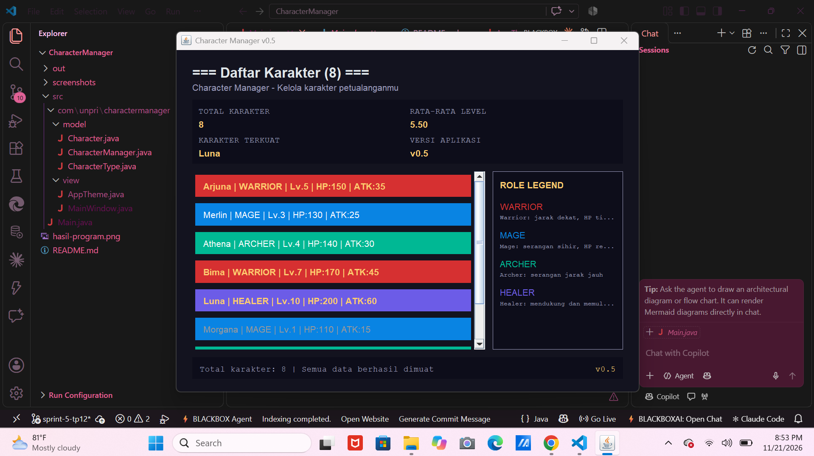

# Character Manager — TP12
## Sprint #5: Layout, UI Responsif & Analisis MVC

**Mata Kuliah:** Java Visual (SIH-6406)  
**Nama:** Chelsi Valentine Harefa  
**NIM:** 253303621254  
**Kelas:** 2 Pagi B  
**Versi Aplikasi:** Character Manager v0.5

---

## A. Deskripsi Proyek

TP12 merupakan pengembangan aplikasi Character Manager dari versi v0.4 menjadi v0.5. Pada sprint ini, aplikasi dikembangkan dengan menerapkan berbagai LayoutManager pada Java Swing agar tampilan lebih terstruktur, fleksibel, dan responsif terhadap perubahan ukuran jendela.

## B. Implementasi LayoutManager

Aplikasi menggunakan beberapa LayoutManager:

1. **BorderLayout** — membagi tampilan utama menjadi NORTH, CENTER, EAST, dan SOUTH.
2. **GridLayout** — menyusun panel statistik role dalam satu baris dengan empat kolom.
3. **BoxLayout** — menyusun Role Legend secara vertikal.
4. **BorderLayout pada wrapper panel** — menjaga kartu karakter tetap tersusun dari bagian atas.
5. **JScrollPane** — memungkinkan pengguna menggulir daftar karakter ketika ruang tampilan terbatas.

## C. Struktur Antarmuka

Pembagian area aplikasi Character Manager v0.5:

| Area | Komponen |
|---|---|
| NORTH | Header dan panel statistik karakter |
| CENTER | Daftar kartu karakter dalam JScrollPane |
| EAST | Role Legend |
| SOUTH | Status bar dan versi aplikasi |

Panel statistik tambahan menggunakan `GridLayout(1, 4, 8, 0)` untuk menampilkan jumlah karakter berdasarkan role WARRIOR, MAGE, ARCHER, dan HEALER.

## D. Nested Panels

Nested panels digunakan untuk membagi antarmuka menjadi beberapa bagian. Header dan panel statistik ditempatkan di dalam panel pembungkus. Daftar kartu karakter juga ditempatkan dalam wrapper panel sebelum dimasukkan ke JScrollPane.

Struktur tersebut membuat setiap bagian memiliki pengaturan layout tersendiri sehingga kode lebih mudah dibaca, dikelola, dan dikembangkan.

## E. Screenshot Aplikasi

### 1. Tampilan Ukuran Awal



### 2. Tampilan Jendela Diperlebar


### 3. Tampilan Jendela Diperkecil


## F. Pengamatan Responsivitas

| Kondisi | Prediksi | Hasil Pengamatan |
|---|---|---|
| Ukuran awal | Komponen tampil sesuai pembagian layout. | Header, statistik, daftar karakter, legend, dan status bar terlihat. |
| Jendela diperlebar | Area CENTER memperoleh ruang lebih besar. | Daftar karakter terlihat lebih leluasa. |
| Jendela diperkecil | Scrollbar membantu melihat daftar karakter. | Scrollbar muncul dan ruang beberapa komponen menjadi lebih terbatas. |

## G. Analisis Pemilihan Layout

GridLayout dipilih untuk panel statistik karena empat informasi role perlu ditampilkan secara sejajar dan memiliki ukuran yang seragam.

BoxLayout dipilih untuk Role Legend karena komponen perlu disusun secara vertikal. FlowLayout tidak dipilih untuk panel statistik karena susunan komponen dapat berubah mengikuti ruang yang tersedia. GridLayout lebih sesuai untuk mempertahankan susunan empat informasi dalam satu baris.

Penggunaan JScrollPane juga membantu pengguna mengakses seluruh daftar karakter ketika ukuran jendela terbatas.

## H. Penerapan Prinsip MVC

Pengaturan tampilan diletakkan di package `view`, sedangkan pengelolaan data tetap berada di package `model`. Pemisahan ini membuat perubahan tampilan tidak harus mengubah bagian model.

Contohnya, daftar karakter dapat diubah dari JLabel menjadi JTable pada bagian view tanpa harus mengubah struktur class Character dan CharacterManager. Dengan demikian, aplikasi lebih mudah dirawat dan dikembangkan.

## I. Laporan Google Docs

Laporan analisis TP12 dapat dibuka melalui tautan berikut:

[**JavaVisual_TP12_253303621254_ChelsiValentineHarefa**](https://docs.google.com/document/d/1CvPSX3oc_1VThhpB-F_o9CvshvVlhdxfwNy2-9j4oZs/edit?usp=sharing)

## J. Struktur File Proyek

```text
CharacterManagerrr/
├── src/
│   ├── Main.java
│   └── com/
│       └── unpri/
│           └── charactermanager/
│               ├── model/
│               │   ├── Character.java
│               │   ├── CharacterManager.java
│               │   └── CharacterType.java
│               └── view/
│                   ├── AppTheme.java
│                   └── MainWindow.java
├── screenshots/
│   ├── tp12-1-ukuran-awal.png
│   ├── tp12-2-ukuran-lebar.png
│   └── tp12-3-ukuran-kecil.png
└── README.md
```

## K. Kesimpulan

Melalui TP12, aplikasi Character Manager berhasil dikembangkan menjadi versi 0.5 dengan menerapkan BorderLayout, GridLayout, BoxLayout, nested panels, dan JScrollPane. Penerapan LayoutManager membuat tampilan lebih terstruktur dan membantu aplikasi menyesuaikan perubahan ukuran jendela. Pengembangan ini juga memperkuat pemahaman mengenai prinsip MVC dalam pemisahan pengelolaan data dan antarmuka pengguna.