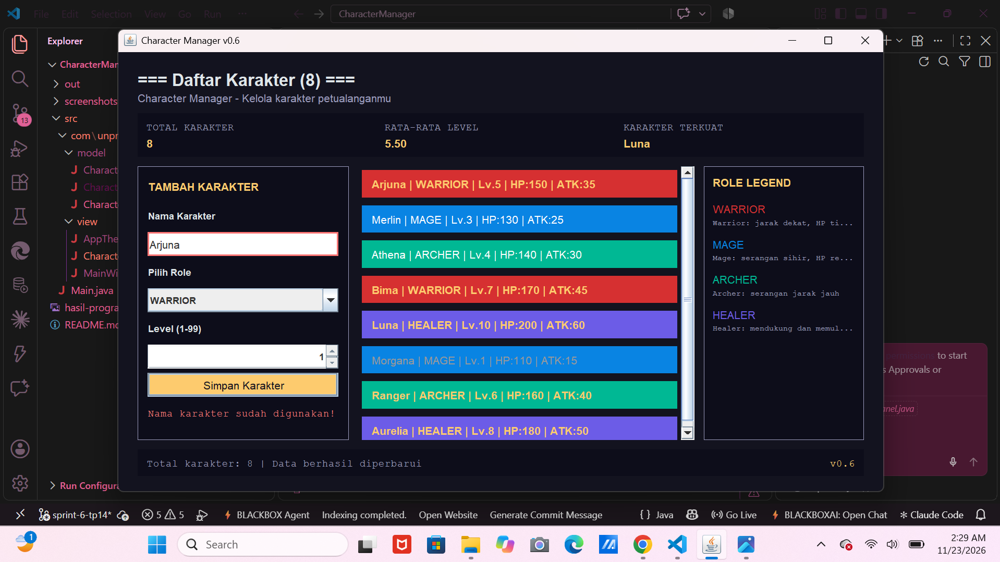

# Character Manager — TP14
## Sprint #6: Form Input, Validasi & Analisis MVC

**Mata Kuliah:** Java Visual (SIH-6406)  
**Nama:** Chelsi Valentine Harefa  
**NIM:** 253303621254  
**Kelas:** 2 Pagi B  
**Versi Aplikasi:** Character Manager v0.6

---

## A. Deskripsi Proyek

TP14 merupakan pengembangan aplikasi Character Manager pada Sprint #6. Pada sprint ini, aplikasi dikembangkan dengan menambahkan form input karakter, validasi data, serta penerapan prinsip Model-View-Controller (MVC).

Pengguna dapat menambahkan karakter melalui antarmuka Java Swing dengan mengisi nama, memilih role, dan menentukan level. Sistem melakukan validasi sebelum karakter ditambahkan ke dalam daftar.

## B. Implementasi Form Input

Form input dibuat menggunakan class `CharacterFormPanel.java` di package `view`.

Komponen yang digunakan:

1. **JTextField** — menerima input nama karakter.
2. **JComboBox<CharacterType>** — menyediakan pilihan role karakter.
3. **JSpinner** — menentukan level karakter dengan rentang 1–99.
4. **JLabel** — menampilkan pesan validasi dan informasi keberhasilan.
5. **JButton** — menjalankan proses penyimpanan karakter.

Setelah karakter berhasil ditambahkan, daftar karakter dan statistik diperbarui melalui `refreshList()`.

## C. Implementasi Validasi

Validasi nama dilakukan melalui method `validateName()` pada `CharacterFormPanel`.

Urutan pemeriksaan nama:

1. Memastikan nama tidak kosong.
2. Memastikan panjang nama minimal 3 dan maksimal 20 karakter.
3. Memastikan nama hanya menggunakan huruf dan spasi.
4. Menolak penggunaan dua spasi berturut-turut.
5. Memastikan nama belum digunakan oleh karakter lain.

Input nama juga menggunakan `trim()` agar spasi di awal dan akhir tidak ikut tersimpan.

Sebelum mengambil nilai level dari JSpinner, program menjalankan `commitEdit()` untuk memastikan nilai yang dimasukkan telah diterapkan.

### Validasi pada Model

Class `Character.java` memiliki validasi untuk memastikan:

- Nama tidak boleh kosong.
- Role tidak boleh bernilai null.
- Level harus berada pada rentang 1–99.
- Role MAGE tidak boleh memiliki level lebih dari 60.

Jika data tidak valid, model melempar `IllegalArgumentException`.

### Validasi Tambahan (Mini Challenge)

Selain validasi utama, terdapat dua aturan tambahan:

1. **Nama tidak boleh memiliki dua spasi berturut-turut.** Aturan ini diterapkan agar penulisan nama lebih rapi dan konsisten.
2. **Jumlah karakter maksimal 20.** Aturan ini diterapkan pada `CharacterManager` agar jumlah data dalam daftar tetap terkendali.

## D. Screenshot Pengujian

### 1. Validasi Nama Kosong

Ketika pengguna menekan tombol simpan tanpa mengisi nama, sistem menampilkan pesan kesalahan dan mengubah border kolom nama menjadi merah.


### 2. Validasi Nama Duplikat

Ketika pengguna memasukkan nama yang sudah digunakan, sistem menolak penambahan karakter dan menampilkan pesan bahwa nama telah digunakan.



### 3. Berhasil Menambahkan Karakter

Ketika seluruh data memenuhi ketentuan, karakter berhasil ditambahkan ke daftar dan jumlah karakter diperbarui.


## E. Tabel Pengujian

| No. | Kasus Pengujian | Input | Hasil yang Diharapkan | Hasil Aktual | Layer |
|---|---|---|---|---|---|
| 1 | Nama kosong | Nama dikosongkan | Ditolak, muncul pesan error | Sesuai | View |
| 2 | Nama terlalu pendek | Al | Ditolak karena kurang dari 3 karakter | Sesuai | View |
| 3 | Nama mengandung angka | Arjuna123 | Ditolak karena format tidak sesuai | Sesuai | View |
| 4 | Dua spasi berturut-turut | Bima  Sakti | Ditolak karena format nama tidak sesuai | Sesuai | View |
| 5 | Nama duplikat | Arjuna | Ditolak karena nama sudah digunakan | Sesuai | View dan Model |
| 6 | MAGE level 61 | MAGE, level 61 | Ditolak karena batas MAGE adalah level 60 | Sesuai | Model |
| 7 | Data karakter valid | Zeus, WARRIOR, level 10 | Karakter berhasil ditambahkan | Sesuai | View dan Model |
| 8 | Batas jumlah karakter | Menambahkan karakter ketika daftar berisi 20 karakter | Penambahan ditolak | Sesuai | Model |

Berdasarkan pengujian tersebut, seluruh kasus menghasilkan respons sesuai dengan hasil yang diharapkan. Tidak ditemukan ketidaksesuaian pada pengujian yang dilakukan.

## F. Penerapan Prinsip MVC

Penerapan MVC dilakukan dengan membagi tanggung jawab program menjadi dua bagian utama:

**Model:**
- `Character.java` mengatur data dan validasi karakter.
- `CharacterManager.java` mengelola daftar karakter, pemeriksaan nama duplikat, dan batas jumlah karakter.
- `CharacterType.java` menyimpan pilihan role karakter.

**View:**
- `CharacterFormPanel.java` menyediakan form input dan menampilkan pesan validasi.
- `MainWindow.java` menampilkan daftar karakter, statistik, dan tampilan utama.
- `AppTheme.java` mengatur warna serta tampilan aplikasi.

Pemisahan tersebut membuat aturan pengelolaan data berada pada Model, sedangkan interaksi dengan pengguna berada pada View.

## G. Analisis dan Kompromi Implementasi

Pada sprint ini, event handling masih menggunakan `ActionListener` secara langsung pada komponen form. Proses penambahan karakter juga dilakukan melalui pemanggilan `CharacterManager` dari bagian View. Pendekatan tersebut dipilih agar alur input dan validasi lebih sederhana serta mudah dipahami pada tahap pembelajaran ini. Pada pengembangan berikutnya, pemisahan tanggung jawab dapat ditingkatkan dengan menambahkan Controller atau service layer agar View tidak berkomunikasi langsung dengan Model.

## H. Laporan Google Docs

Laporan analisis TP14 berisi pembahasan mengenai validasi input, perbedaan validasi format dan semantik, validasi dua lapisan, prinsip pesan kesalahan, serta penggunaan casting pada komponen Swing.

**Tautan Google Docs:** Akan ditambahkan setelah laporan TP14 selesai dibuat.

## I. Struktur File Proyek

```text
CharacterManagerrr/
├── src/
│   ├── Main.java
│   └── com/
│       └── unpri/
│           └── charactermanager/
│               ├── model/
│               │   ├── Character.java
│               │   ├── CharacterManager.java
│               │   └── CharacterType.java
│               └── view/
│                   ├── AppTheme.java
│                   ├── CharacterFormPanel.java
│                   └── MainWindow.java
├── screenshots/
│   ├── TP14_validasi_nama_kosong.png
│   ├── TP14_validasi_nama_duplikat.png
│   └── TP14_berhasil_tambah_karakter.png
└── README.md
```

## J. Kesimpulan

Melalui TP14, aplikasi Character Manager berhasil dikembangkan dengan fitur form input karakter dan validasi pada View maupun Model. Penggunaan JTextField, JComboBox, dan JSpinner mempermudah pengguna memasukkan data karakter. Validasi berlapis membantu menjaga agar data yang masuk sesuai aturan aplikasi. Pengembangan ini juga memperkuat pemahaman mengenai pemisahan tanggung jawab berdasarkan prinsip MVC.