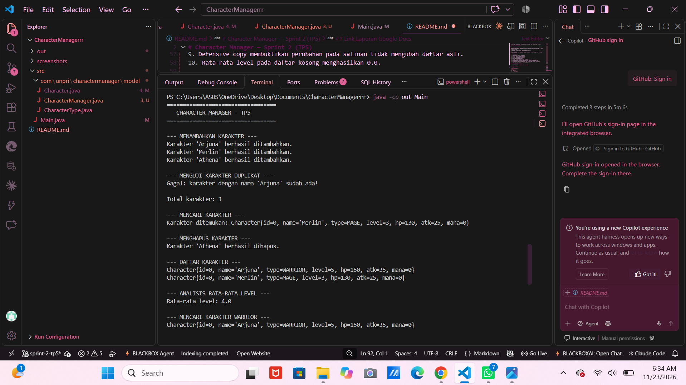

# Character Manager — Sprint 2 (TP5)

## CharacterManager, Analytics & Object Reference

**Mata Kuliah:** Java Visual (SIH-6406)  
**CPMK:** 1  
**SCPMK:** 2

## Deskripsi

Pada Sprint 2 (TP5), aplikasi Character Manager dikembangkan dengan menerapkan pengelolaan kumpulan objek menggunakan ArrayList, method equals(), pencarian, penghapusan, serta analisis data karakter.

## Fitur Utama

- Implementasi equals() untuk membandingkan karakter berdasarkan nama.
- Menambahkan karakter menggunakan addCharacter().
- Menolak karakter dengan nama duplikat.
- Mencari karakter menggunakan findByName().
- Menghapus karakter menggunakan removeCharacter().
- Menghitung jumlah karakter menggunakan getTotalCharacters().
- Mengambil daftar karakter menggunakan getAllCharacters().
- Menerapkan defensive copy.
- Menghitung rata-rata level menggunakan getAverageLevel().
- Mencari karakter berdasarkan tipe menggunakan findByType().

## Mini Challenge

### 1. getAverageLevel()

Menghitung rata-rata level seluruh karakter. Jika daftar karakter kosong, method mengembalikan nilai 0.

### 2. findByType()

Mencari dan mengembalikan daftar karakter berdasarkan tipe CharacterType tertentu.

## Fitur Analisis Tambahan

### findStrongest()

Method findStrongest() digunakan untuk mencari karakter dengan level tertinggi di dalam CharacterManager.

Jika daftar karakter kosong, method mengembalikan null.

Fitur ini dibuat untuk memudahkan pengguna mengetahui karakter dengan level tertinggi secara otomatis.

## Hasil Pengujian

1. Tiga karakter berhasil ditambahkan.
2. Karakter duplikat berhasil ditolak.
3. Karakter Merlin berhasil ditemukan.
4. Karakter Athena berhasil dihapus.
5. Rata-rata level menghasilkan 4.0.
6. Karakter bertipe WARRIOR berhasil ditemukan.
7. Arjuna berhasil ditemukan sebagai karakter dengan level tertinggi.
8. Object reference menunjukkan kedua referensi mengarah ke objek yang sama.
9. Defensive copy membuktikan perubahan pada salinan tidak mengubah daftar asli.
10. Rata-rata level pada daftar kosong menghasilkan 0.0.

## Screenshot Output Program



## Struktur Folder

```text
CharacterManagerrr/
├── src/
│   ├── Main.java
│   └── com/
│       └── unpri/
│           └── charactermanager/
│               └── model/
│                   ├── Character.java
│                   ├── CharacterType.java
│                   └── CharacterManager.java
├── screenshots/
│   └── hasil-tp5.png
└── README.md
```

## Identitas Mahasiswa

- Nama: Chelsi Valentine Harefa
- NIM: 253303621254
- Kelas: 2 Pagi B
- Mata Kuliah: Java Visual (SIH-6406)

## Link Laporan Google Docs

https://docs.google.com/document/d/1Qa3dCUf4u4hepcE3vYz8KQwR3NZRN3iRZ17y6c4-nPk/edit?usp=sharing
