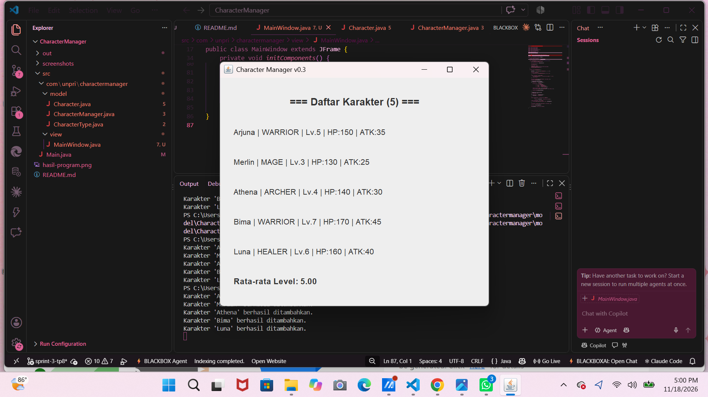
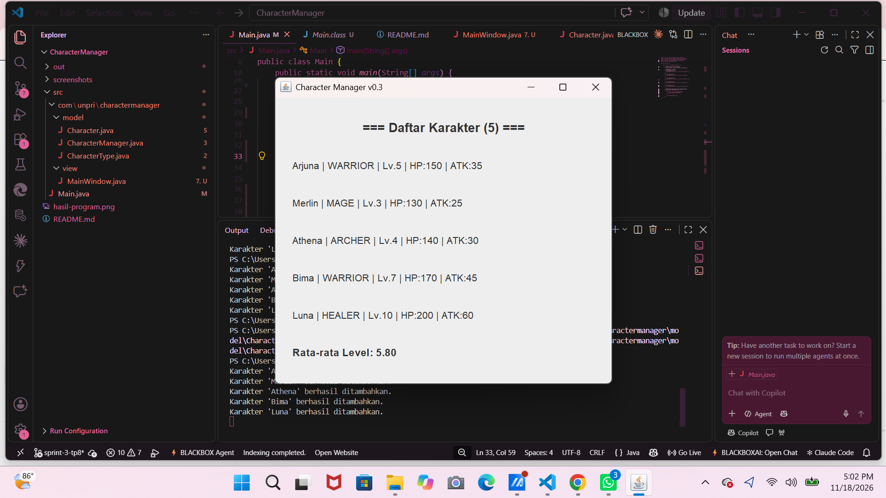

# Character Manager — Sprint 3 (TP8)

## MainWindow, Data Dinamis & Analisis MVC

**Mata Kuliah:** Java Visual (SIH-6406)  
**CPMK:** 2  
**SCPMK:** 3

## Deskripsi

Pada Sprint 3 (TP8), aplikasi Character Manager dikembangkan dengan menambahkan antarmuka grafis (GUI) menggunakan Java Swing. Aplikasi menampilkan daftar karakter secara dinamis melalui JFrame dan JLabel serta menampilkan informasi rata-rata level karakter.

## Fitur Utama

- Membuat GUI menggunakan Java Swing.
- Mengimplementasikan MainWindow yang mewarisi JFrame.
- Menampilkan daftar karakter secara dinamis menggunakan perulangan.
- Menampilkan nama, tipe, level, HP, dan attack power karakter.
- Menampilkan jumlah karakter.
- Menghitung dan menampilkan rata-rata level karakter.
- Menjalankan GUI menggunakan SwingUtilities.invokeLater().
- Mengatur tampilan karakter secara vertikal menggunakan BoxLayout.

## Data Karakter

Aplikasi menggunakan lima karakter:

| Nama | Tipe | Level |
|---|---|---:|
| Arjuna | WARRIOR | 5 |
| Merlin | MAGE | 3 |
| Athena | ARCHER | 4 |
| Bima | WARRIOR | 7 |
| Luna | HEALER | 10 |

Karakter Bima ditambahkan sebagai karakter bertipe WARRIOR dengan level 7 karena memiliki kemampuan bertarung yang kuat. Karakter Luna ditambahkan sebagai HEALER dengan level 10 untuk melengkapi variasi peran karakter dalam aplikasi.

## Hasil Pengujian

### 1. Sebelum Perubahan Data

Luna memiliki level 6. Rata-rata level dari lima karakter adalah 5.0.



### 2. Sesudah Perubahan Data

Level Luna diubah dari 6 menjadi 10. Setelah program dijalankan kembali, rata-rata level berubah menjadi 5.8.



Pengujian ini membuktikan bahwa perubahan data karakter memengaruhi hasil perhitungan rata-rata level yang ditampilkan pada GUI.

## Analisis MVC

Alur program dimulai dari Main.java yang membuat objek CharacterManager dan menambahkan data karakter. Selanjutnya, CharacterManager mengelola kumpulan data karakter serta menghitung rata-rata level. Data tersebut kemudian dikirimkan ke MainWindow untuk ditampilkan menggunakan komponen Java Swing.

Penerapan ini sesuai dengan konsep MVC (Model-View-Controller), yaitu Model bertanggung jawab mengelola data dan logika, sedangkan View bertanggung jawab menampilkan informasi kepada pengguna. Main.java berperan sebagai pengatur jalannya aplikasi dan menghubungkan Model dengan View.

## Event Dispatch Thread (EDT)

Aplikasi menggunakan SwingUtilities.invokeLater() untuk menjalankan pembuatan dan penampilan GUI melalui Event Dispatch Thread (EDT). Penggunaan EDT membantu menjaga agar antarmuka Swing berjalan dengan aman dan responsif.

## Struktur Folder

```text
CharacterManagerrr/
├── src/
│   ├── Main.java
│   └── com/
│       └── unpri/
│           └── charactermanager/
│               ├── model/
│               │   ├── Character.java
│               │   ├── CharacterType.java
│               │   └── CharacterManager.java
│               └── view/
│                   └── MainWindow.java
├── screenshots/
│   ├── hasil-tp5.png
│   ├── tp8-sebelum.png
│   └── tp8-sesudah.png
└── README.md
```

## Identitas Mahasiswa

- **Nama:** Chelsi Valentine Harefa
- **NIM:** 253303621254
- **Kelas:** 2 Pagi B
- **Mata Kuliah:** Java Visual (SIH-6406)

## Link Laporan Google Docs TP8
https://docs.google.com/document/d/1kIS5dgznQwIm7O-5p7fOIhc0tNEwpKesG9T6N37T1bE/edit?usp=sharing